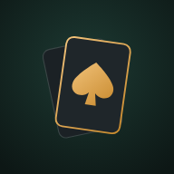
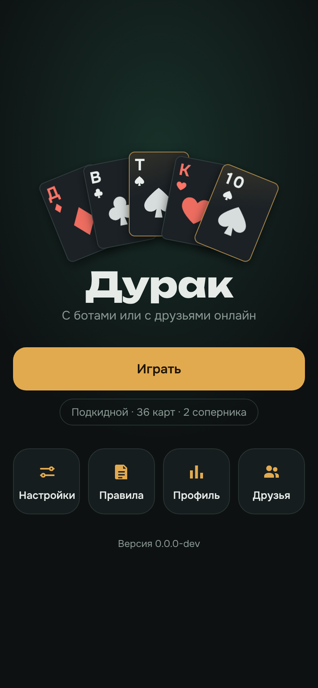
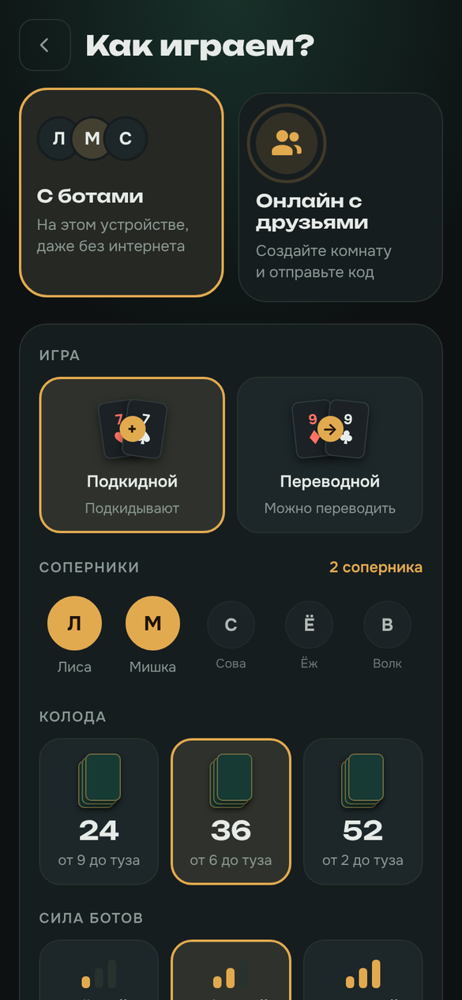
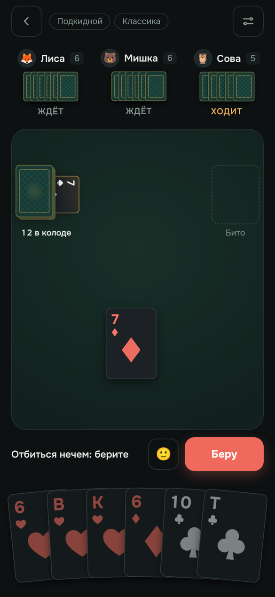
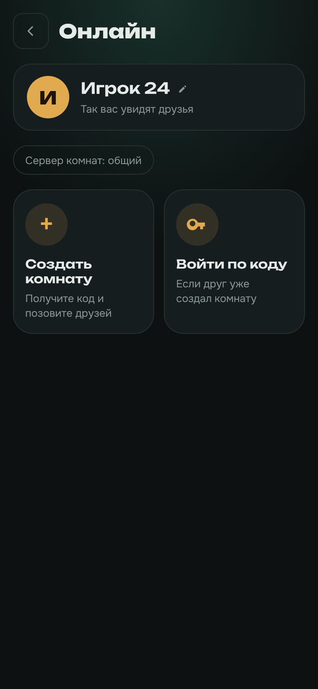
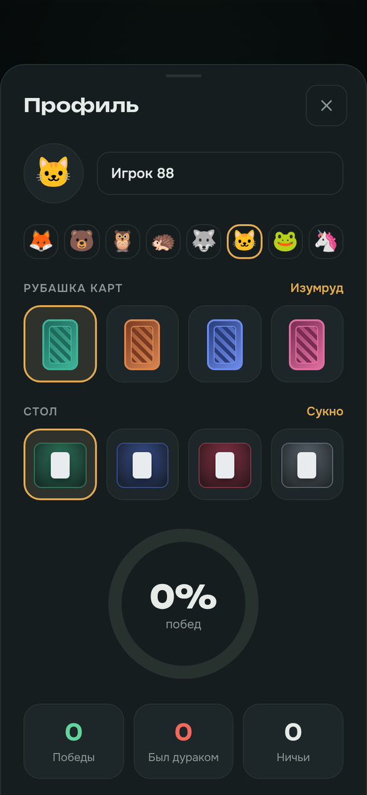
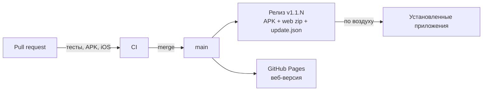

<div align="center">



# Дурак

**Карточная игра «Дурак» с тёмным столом, латунным акцентом и анимацией на каждом шаге.**
Играйте с ботами без интернета или с друзьями онлайн по коду комнаты. Одна кодовая база для браузера, Android и iPhone.

[](https://chvdbhcx-del.github.io/durak/)
[](https://github.com/chvdbhcx-del/durak/releases/latest)

[](https://github.com/chvdbhcx-del/durak/actions/workflows/ci.yml)
[](https://github.com/chvdbhcx-del/durak/actions/workflows/release.yml)
[](https://github.com/chvdbhcx-del/durak/actions/workflows/pages.yml)


</div>

<br>

<table align="center">
  <tr>
    <td align="center"><br><sub>Меню</sub></td>
    <td align="center"><br><sub>Настройка партии</sub></td>
    <td align="center"><br><sub>За столом</sub></td>
  </tr>
  <tr>
    <td align="center"><br><sub>Онлайн по коду</sub></td>
    <td align="center"><br><sub>Профиль и статистика</sub></td>
    <td align="center" valign="middle">
      <b>Карты, иконка и всё оформление</b><br>нарисованы с нуля<br><br>
      <a href="https://chvdbhcx-del.github.io/durak/"><b>Открыть игру →</b></a>
    </td>
  </tr>
</table>

---

## ♠ Что внутри

|  |  |
|---|---|
| 🃏 **Два вида дурака** | Подкидной и переводной. Колода на 24, 36 или 52 карты |
| 🎭 **Классика или «Шулер»** | В режиме «Шулер» можно отбиться или подкинуть любую карту. Заметили подозрительный отбой — нажмите на него и поймайте. Кого поймали, тот больше жульничать не сможет |
| 🏆 **Турнир** | Серия из 3 или 5 партий с ботами, счёт виден прямо на столе. Побеждает тот, кто реже остался дураком |
| 🤖 **Боты трёх уровней** | Лёгкий, обычный и сильный. От уровня зависит, как часто бот блефует и как часто ловит шулера (15, 30 или 50%). Сильный бот просчитывает эндшпиль |
| 🌐 **Онлайн по коду комнаты** | Создайте комнату, отправьте код или ссылку. Игроки соединяются напрямую через WebRTC, комната переживает перезагрузку страницы |
| 👥 **Друзья** | Добавьте друга по его ID, видно, кто сейчас в игре, приглашение приходит одним касанием |
| 📊 **Профиль и статистика** | Имя, аватар, рубашка карт и цвет стола. Победы, серии и доля побед отдельно по режимам, правилам и силе ботов |
| ✨ **Живой стол** | Плавные полёты карт, перетаскивание, веер руки, эмоции и реплики «Беру», «Пас», «Бито», конфетти на победе |
| 🔊 **Звук и вибрация** | Настоящие записи шороха карт, вибрация на телефоне |
| 🌗 **Тёмная и светлая тема** | Тёмная по умолчанию, светлая или как в системе |

## 📱 Где играть

| Платформа | Как установить |
|---|---|
| 🌐 **Браузер** | Откройте **[chvdbhcx-del.github.io/durak](https://chvdbhcx-del.github.io/durak/)**. Работает и без интернета (кроме онлайна) |
| 🤖 **Android** | Скачайте `Durak-<версия>.apk` из [последнего релиза](https://github.com/chvdbhcx-del/durak/releases/latest) и установите. Дальше приложение обновляется само |
| 🍏 **iPhone и iPad** | Откройте сайт в Safari, «Поделиться» → «На экран „Домой“». Игра запустится как отдельное приложение |

## 🛠 Стек

| Слой | Что используется |
|---|---|
| Интерфейс | React 18, TypeScript, Framer Motion, шрифты Onest и Unbounded |
| Сборка | Vite 5, PWA (manifest + service worker) |
| Правила и боты | Чистый TypeScript в `src/engine`, без зависимостей от интерфейса, тесты на Vitest |
| Онлайн | PeerJS (WebRTC), хост комнаты ведёт партию, остальные получают своё представление стола |
| Телефоны | Capacitor 8 (Android и iOS), обновления по воздуху через `@capgo/capacitor-updater` |
| CI/CD | GitHub Actions: тесты, APK, сборка iOS, релизы, GitHub Pages |

## 🚀 Запуск у себя

Нужен Node.js 22 (подойдёт и 18+).

```bash
git clone https://github.com/chvdbhcx-del/durak.git
cd durak
npm install

npm run dev           # локальный сервер с горячей перезагрузкой
npm test              # тесты правил, ботов, комнат и настроек
npm run build         # сборка в dist/
npm run preview       # посмотреть сборку
npm run build:single  # вся игра одним HTML-файлом в dist-single/
```

### Телефоны

```bash
npm run build && npx cap sync
npx cap open android   # Android Studio
npx cap open ios       # Xcode (нужен Mac)
```

## 📦 Релизы и обновления



- **Каждый PR** прогоняет тесты, собирает APK и проверяет сборку для iOS-симулятора.
- **Каждый мерж в `main`** выпускает [релиз](https://github.com/chvdbhcx-del/durak/releases): подписанный APK, архив веб-части и `update.json`, и публикует сайт на GitHub Pages. Номер версии у сайта и приложения общий.
- **Приложение** при запуске и раз в полчаса проверяет последний релиз, скачивает новую веб-часть в фоне (с проверкой SHA-256) и применяет её, когда партия не идёт. Если поменялась нативная часть, оно предложит скачать новый APK.
- **Подпись APK** берётся из секретов `ANDROID_KEYSTORE_BASE64` и `ANDROID_KEYSTORE_PASSWORD` (алиас `durak`).

## 🗂 Структура

```
src/
  engine/        правила, ходы, боты, эмоции + тесты
  net/           онлайн-комнаты и друзья на PeerJS + тесты
  ui/            экраны, стол, карты, панели, звуки, обновления
  assets/sounds/ звуки карт (CC0)
public/          иконки, manifest, service worker
android/ ios/    нативные проекты Capacitor
server/          необязательный свой сервер комнат (см. server/README.md)
scripts/         сборка update.json для релиза
.github/         CI, релизы, веб-версия
```

## 🙏 Благодарности

- Звуки карт: **[Casino Audio](https://kenney.nl/assets/casino-audio)** от Kenney, лицензия CC0. Подробности в [`src/assets/sounds/CREDITS.md`](src/assets/sounds/CREDITS.md).
- Шрифты [Onest](https://fonts.google.com/specimen/Onest) и [Unbounded](https://fonts.google.com/specimen/Unbounded), лицензия SIL OFL.
- Карты, рубашки, иконка и интерфейс сделаны специально для этого проекта.

---

<details>
<summary><b>🇬🇧 English</b></summary>

<br>

**Durak** is the classic Russian card game, rebuilt with a dark felt table, brass accents and animation on every move. It runs in the browser, on Android and on iPhone from one codebase.

- **Modes:** Podkidnoy (throw-in) and Perevodnoy (transfer), 24/36/52-card decks.
- **Rules:** classic, or *Cheat* mode where any card can be played and opponents may catch you.
- **Tournaments** of 3 or 5 games against bots, with the score on the table.
- **Bots** in three strengths (easy, normal, hard). Strength sets how often they bluff and how often they catch cheats.
- **Online play** by room code over WebRTC (PeerJS), plus a friends list with presence and one-tap invites.
- **Profile** with avatar, card back and table colour, and stats by mode, rules and bot strength.

**Play:** [chvdbhcx-del.github.io/durak](https://chvdbhcx-del.github.io/durak/) · **Android:** APK from the [latest release](https://github.com/chvdbhcx-del/durak/releases/latest) · **iPhone:** open the site in Safari and add it to the Home Screen.

**Develop:** `npm install`, then `npm run dev`, `npm test`, `npm run build`. Native shells: `npx cap sync && npx cap open android|ios`.

Built with React 18, TypeScript, Vite, Framer Motion, Capacitor 8 and PeerJS. Every merge to `main` ships a signed APK, an over-the-air web bundle and the GitHub Pages site.

</details>

<div align="center">
<sub>Сделано с ♠ ♥ ♦ ♣</sub>
</div>
